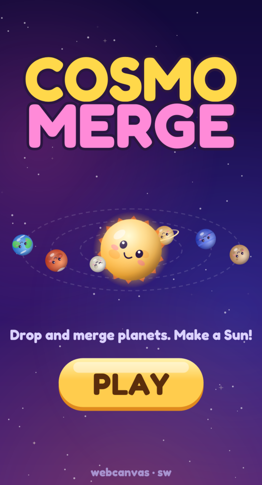
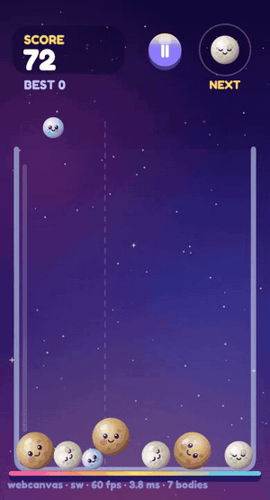
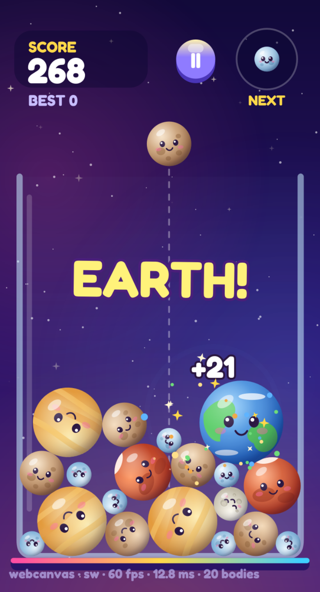
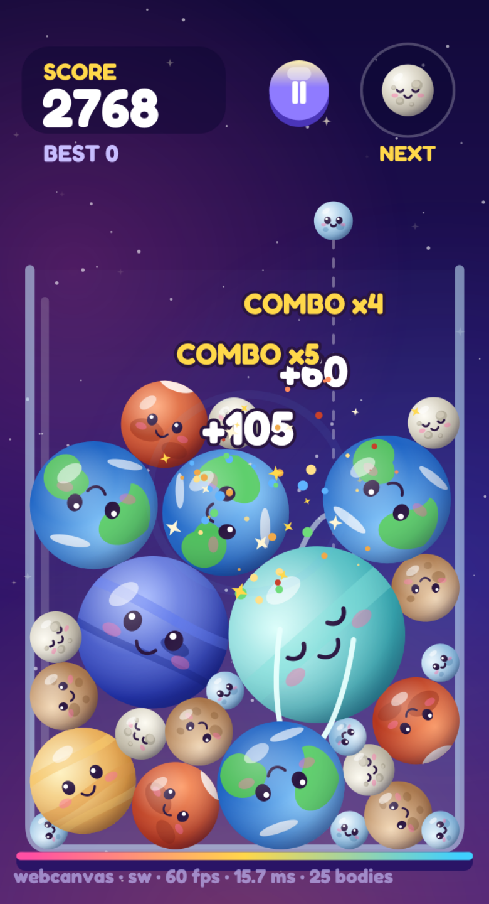
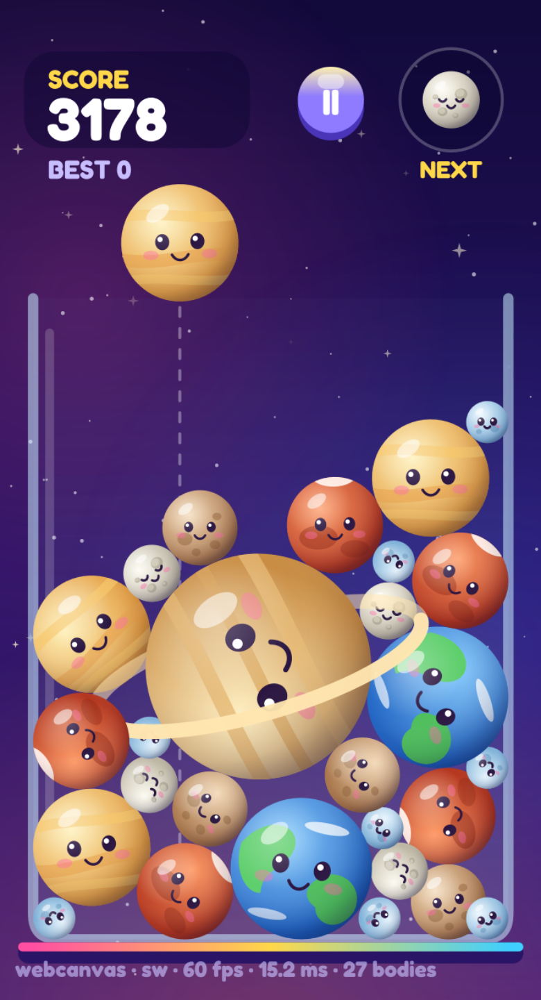

<div align="center">



# Cosmo Merge

**Drop planets. Merge them. Make a Sun.**

A cozy, physics-y merge puzzle set in space, playable in the browser, on iOS and Android, and on desktop.

</div>

---

<div align="center">
  
</div>

## How to play

1. **Aim.** Drag left and right to move the planet along the top of the jar.
2. **Drop.** Let go and it falls in, bouncing and rolling into place.
3. **Merge.** When two of the same planet touch, they fuse into the next, bigger one.
4. **Don't overflow.** If planets stay above the rim too long, it's game over.

The **NEXT** badge in the corner shows what's coming, so plan a move ahead.

## The road to the Sun

Every merge climbs one step up the solar system:

> ☄️ Comet → 🌑 Moon → Mercury → 🔴 Mars → Venus → 🌍 Earth → 🔵 Neptune → Uranus → 🪐 Saturn → Jupiter → ☀️ **Sun**

You only ever drop the small stuff (Comet up to Venus). Everything bigger has to be built. The first time you make Earth or anything above it, the game calls it out. And if you get two Suns to touch, they go **supernova** for a huge bonus and leave the jar a little emptier.

<div align="center">
  
  &nbsp;
  
  &nbsp;
  
</div>

## Scoring

- Each merge scores the value of the planet it makes. Bigger planets are worth much more.
- **Combos.** Merges that land within about a second of each other chain up to **x5**. A drop that sets off a cascade is where the big scores come from.
- **Supernova.** Two Suns merging is worth 500 × your current combo.
- Your best score is saved between runs.

## Feel

Planets have little faces and roll as they move. Merges burst into particles and rings, big ones shake the screen, and every drop and merge has its own sound (and haptics on phones). The rim glows and flashes as the jar gets close to overflowing, so you always get a warning.

## Play it

```sh
yarn
yarn web              # browser, http://localhost:5173
yarn ios              # iOS
yarn android          # Android
yarn desktop          # desktop window (macOS, Windows, Linux)
```

Add `?autoplay` to the web URL to watch the game play itself.

## Built with

- [`@thorvg/webcanvas`](https://www.npmjs.com/package/@thorvg/webcanvas) for rendering on the web
- [`thorvg-react-native`](https://www.npmjs.com/package/thorvg-react-native) on iOS and Android
- [`thorvg-canvas`](https://www.npmjs.com/package/thorvg-canvas)  on desktop with SDL3
